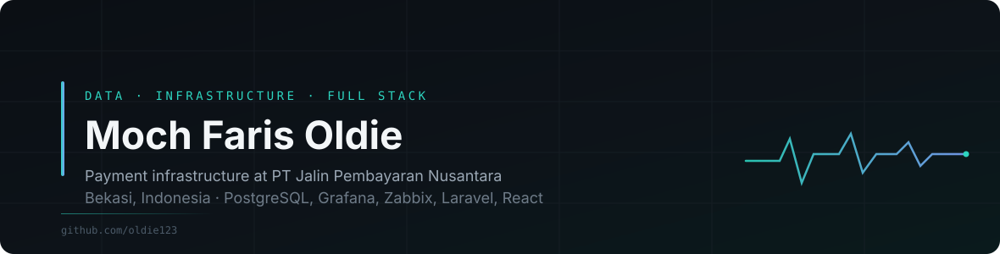

  <picture>
    <source media="(prefers-color-scheme: dark)" srcset="assets/hero-dark.svg">
    <source media="(prefers-color-scheme: light)" srcset="assets/hero-light.svg">
    
  </picture>

I work on payment infrastructure at **PT Jalin Pembayaran Nusantara**: turning transaction and incident data into dashboards operations can act on, and keeping the servers behind them observable. Before that I built web apps end to end, from PostgreSQL schema to React interface.

**Currently** — Data Analyst & Infrastructure Monitoring Specialist, since Dec 2024. Grafana on PostgreSQL for peak settlement reporting, complex SQL across PostgreSQL and MySQL, n8n pipelines that replaced manual reporting, Zabbix items and triggers with Telegram alerting, and the JMS to JIVA integration in Laravel.

**Stack I reach for daily** — PostgreSQL, MySQL, Grafana, Zabbix, n8n, Laravel, React, Linux (Ubuntu, RHEL 9).

**Studying** — Bachelor of Informatics Engineering at Universitas Siber Asia, expected 2027. Diploma from Politeknik Negeri Semarang, 2024.

## Selected work

**Settlement & incident reporting** — Grafana dashboards on PostgreSQL that give operations real-time visibility into settlement peaks spread across multiple databases. I owned the queries, the data model, and the visualisation.

**Infrastructure monitoring** — Zabbix templates, items and triggers for CPU, memory and disk across payment servers, wired into Telegram alerts with thresholds read from the database instead of hardcoded.

**JMS to JIVA integration** — Laravel and PHP service that moves incident ticket queues into JIVA through secure API endpoints, taking a manual step out of operations.

**WhatsApp automation** — n8n workflows backed by Node.js and Supabase, built to take repetitive messaging off a human's plate.

More at [oldie-portofolio.vercel.app](https://oldie-portofolio.vercel.app).

## Toolbox

  

  

## Where I've worked

| Role | Company | Period |
| --- | --- | --- |
| Data Analyst & Infrastructure Monitoring Specialist | PT Jalin Pembayaran Nusantara | Dec 2024 – now |
| Web Developer & Database Support | PT Rapier Technology International | Jan 2024 – Nov 2024 |
| Web Developer Intern | PT Rapier Technology International | Aug 2023 – Dec 2023 |

## Reach me

[LinkedIn](https://www.linkedin.com/in/faris-oldie) · [Email](mailto:farisoldie@gmail.com) · [Portfolio](https://oldie-portofolio.vercel.app)

Open to conversations about data engineering, observability, and backend work in fintech.

  <picture>
    <source media="(prefers-color-scheme: dark)" srcset="https://raw.githubusercontent.com/oldie123/oldie123/output/pacman-contribution-graph-dark.svg">
    <source media="(prefers-color-scheme: light)" srcset="https://raw.githubusercontent.com/oldie123/oldie123/output/pacman-contribution-graph.svg">
    
  </picture>

