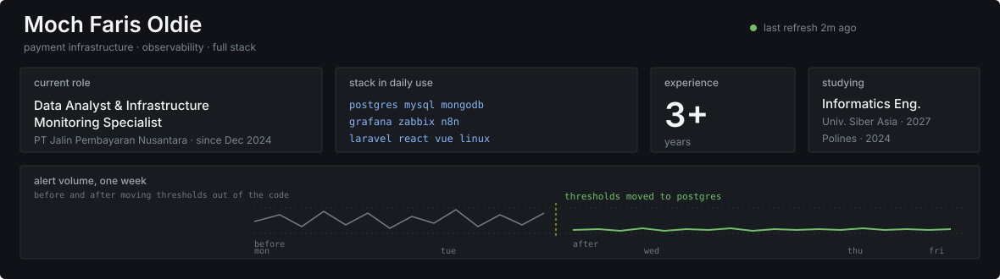

  <picture>
    <source media="(prefers-color-scheme: dark)" srcset="assets/dashboard-dark.svg">
    <source media="(prefers-color-scheme: light)" srcset="assets/dashboard-light.svg">
    
  </picture>

I keep a payment switch observable. Most days that means PostgreSQL queries, Grafana panels, and a Zabbix instance that pings our Telegram when a disk gets full.

Job title says Data Analyst & Infrastructure Monitoring Specialist at PT Jalin Pembayaran Nusantara. Started December 2024. Before that, two years at Rapier on Laravel and React apps, plus a stretch fixing Postgres backups and WAL archives that nobody else wanted.

## What the work looks like

Settlement numbers sit in a few tables across two databases. I write the queries that pull them together, and the dashboard operations opens at 8am every day. When a number looks off, I trace it back through the tables until it makes sense.

The alerting panel above is the part I'm happiest with. Thresholds used to live in the code, so every small spike woke someone up. We moved them into Postgres, and the noisy week on the left became the quiet one on the right.

The JMS to JIVA migration was mine too. Laravel service, queue handling, secure API calls. It deleted a copy-paste step from someone's shift, which is the part I actually care about.

## Tools

  

  

Zabbix, n8n and Supabase aren't in that icon set, and neither is SQL as a language. Those live here instead: Zabbix for server monitoring, n8n for the reporting pipelines that used to be manual, Supabase behind the WhatsApp bot.

## Background

Bekasi, Indonesia. Diploma from Politeknik Negeri Semarang in 2024, now finishing a bachelor at Universitas Siber Asia, expected 2027.

[LinkedIn](https://www.linkedin.com/in/faris-oldie) · [Email](mailto:farisoldie@gmail.com) · [Portfolio](https://oldie-portofolio.vercel.app)
